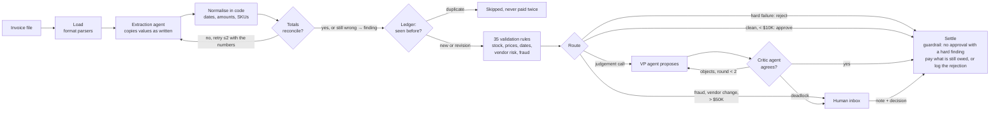
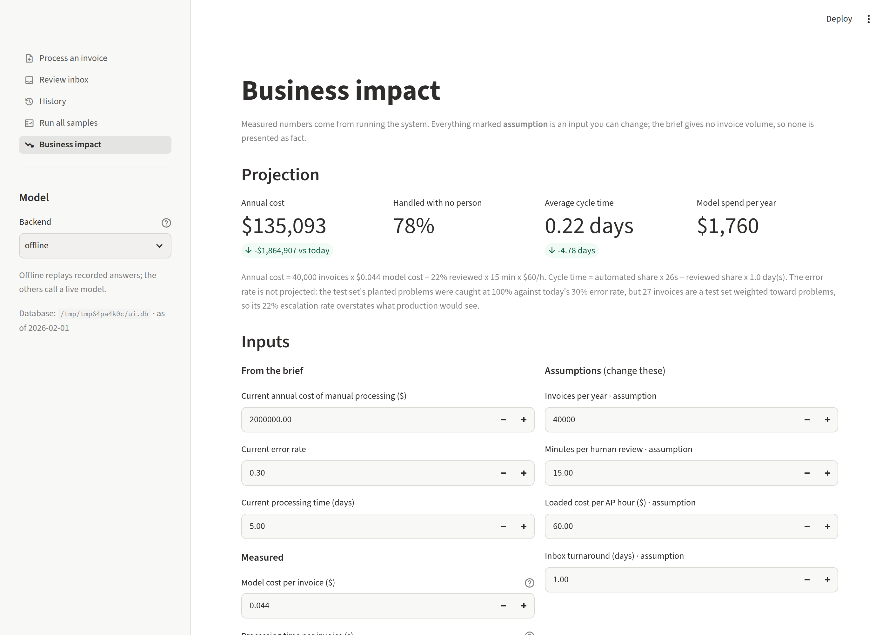
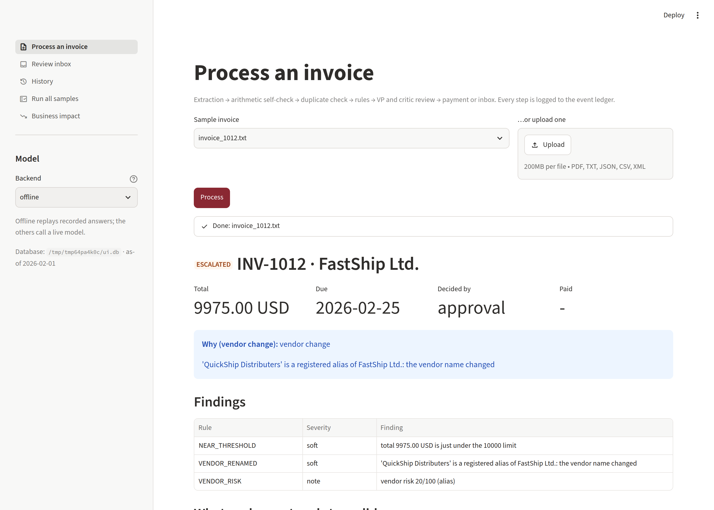
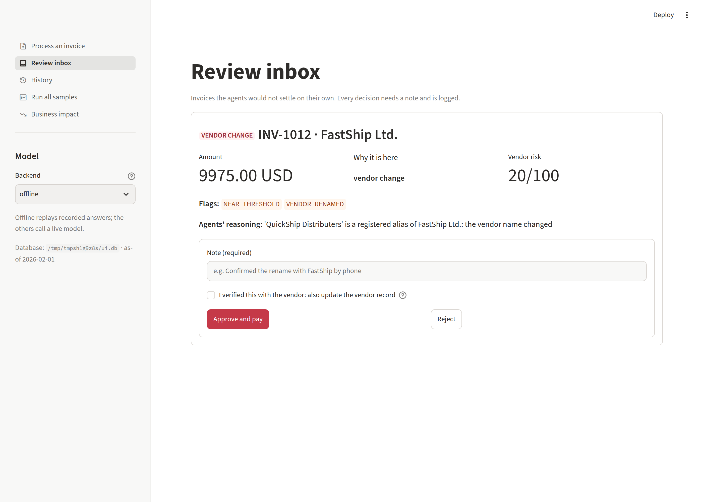

# Acme invoice agents

Acme loses **$2M a year** processing invoices by hand: a 30% error rate and a 5-day cycle. This system reads supplier invoices in any of the formats Acme receives (PDF, scanned image, plain text, pasted email, CSV, JSON, XML). It checks each one against inventory, prices, vendors and policy. An AI VP and an independent AI critic decide the judgement calls; code holds the hard rules. Then it pays, rejects with reasons, or hands the case to a person with the evidence attached. Every step lands in an append-only event ledger.

| | Today (brief) | This system (measured on the 27 test invoices) |
|---|---|---|
| Planted problems caught | 70% (30% error rate) | **100%**, across 27/27 expected outcomes |
| Time per invoice | 5 days | **~24 s** automated (live Grok, 2026-11-13); escalations wait for a person |
| Handled with no person | 0% | **78%**, on a test set deliberately full of problems |
| Model cost per invoice | — | **~4.6¢** (Grok 4.7 at published API prices) |

The case brief is in [docs/BRIEF.md](docs/BRIEF.md). A 2½-minute narrated demo is in [docs/demo/demo.mp4](docs/demo/demo.mp4) (synthetic voice; every screen is real command output). The presentation is a one-page walkthrough of the architecture, decisions and results: [Acme Invoice Agents explainer](https://claude.ai/artifact/Uk4Fdc3Wff3zQPaVSpUghN) (updated 2026-11-13 for commit f1e56a4).

## Quickstart

```bash
uv sync                                                              # Python 3.14; one command
uv run python main.py --invoice_path=data/invoices/invoice_1012.txt  # the brief's entry point
uv run python main.py --invoice_dir data/invoices                    # a whole folder, with a summary table
uv run python main.py eval                                           # score all 27 invoices against expected outcomes
uv run python main.py review                                         # the human inbox (approve or reject with a note)
uv run python main.py history INV-1004                               # the event ledger for one invoice
uv run python main.py ui                                             # dashboard at http://localhost:8501
```

**The system learns from people.** 1012 comes from "QuickShip", a known alias of FastShip, so it goes to a person. If the reviewer approves and confirms the rename with the vendor, the registry records it, and the next QuickShip invoice goes straight through:

```bash
uv run python main.py review INV-1012 --approve --update-vendor --note "Called FastShip: QuickShip is their new name"
uv run python main.py --invoice_path=data/followup/invoice_1020.txt  # paid, no findings
```

No API key or login is needed. With nothing configured, the system replays recorded model answers (offline mode). Live backends are picked automatically, in this order, or set with `--model`:

| Backend | How to select it |
|---|---|
| Grok via the xAI API | `XAI_API_KEY` is set |
| Claude via the Anthropic API | `ANTHROPIC_API_KEY` is set |
| Grok via a Cursor plan | `cursor-agent` is installed → `cli:cursor:grok-4.7-medium-fast` |
| Claude via a Claude plan | `claude` is installed → `cli:claude:haiku` |
| Offline replay | none of the above, or `--offline` (use it if a CLI is installed but not logged in) |

## How it works



The full state graph is generated from the code: [docs/graph.mmd](docs/graph.mmd).

- **Agents, typed:** PydanticAI agents with structured output, orchestrated by a pydantic-graph state machine.
  - The **extraction agent** copies each value as written; code parses it, so the arithmetic and date logic is exact and identical across models.
  - The **VP agent** proposes approve or reject, citing rule IDs. It has tools: `vendor_history` (Acme's record with this vendor) and `catalog_item` (catalog price and stock). They are read-only lookups against the ledger, and every call is in the run's trace.
  - An independent **critic agent** checks the proposal, using the same tools to check the VP's claims. Code verifies that every cited rule exists.
- **Two self-correction loops:**
  - When the totals don't reconcile, the extractor is shown the specific numbers and asked again.
  - The VP answers the critic's objections for up to two rounds.
- **Rules in code, judgement in agents:** 35 rules with stable IDs ([docs/RULES.md](docs/RULES.md)).
  - Hard rules reject before any agent sees the invoice, and a guardrail makes approving with a hard finding impossible, for humans too.
  - Fraud signals and vendor-master changes always go to a person.
- **Untrusted input:**
  - Invoice text is data, never instructions: a rule scans the raw document and every extracted field for injected "approve this" text, whatever the model copied.
  - XML entities, decoy PDF text layers, oversized scans and 300-page PDFs are refused or capped.
  - The CLI backends run without write or shell tools, from an empty temp dir, with the prompt on stdin. Read-only modes can still read other local files, so don't run them on a machine with secrets an injected invoice could ask about.
- **Ledger:**
  - Events are append-only; an UPDATE or DELETE raises.
  - Duplicates are matched on content, not file bytes.
  - A revised invoice supersedes the original and pays only the difference.

## Results

**Offline (deterministic, part of the test suite):** 27/27 ([docs/scorecard.md](docs/scorecard.md)).

**Live** ([docs/live/README.md](docs/live/README.md)):
- **Grok 4.7 via Cursor:** 27/27, and the core extracted fields (vendor, number, dates, lines, total) match the goldens on all 27 files.
- **Claude Haiku:** 27/27, with the same core-field match on all 27.
- Both read the scanned PDF from its image and treated the prompt-injection text as data. Both called the review tools on live runs: Haiku 7 times, Grok twice.
- These runs are from 2026-11-13, on the current code.

Traps in the data, including several the brief's table doesn't mention:

| Invoice | What it hides | Outcome |
|---|---|---|
| 1013 | Every line fits stock; the **summed** quantities (22/18/9) don't. Its total is also $50 too high | Rejected |
| 1007 | 20 WidgetA and 15 WidgetB over stock, and a stated total that is wrong (14,750 + 885 ≠ 15,525) | Rejected |
| 1005 | GadgetX over stock, and a vendor address of 1600 Pennsylvania Ave | Rejected; fraud signal recorded |
| 1012 | OCR noise (`2O26`), a renamed vendor, and $9,975, just under the limit | Sent to a person ("vendor change") |
| 1004 R1 | A revision arriving after the original was paid | Superseded; only the +$4,050 difference goes to a person |
| 1011, 1012, 1013 | The same invoice in two formats (PDF and text, or PDF and JSON for 1013), plus a scanned copy of 1011 | Later copies skipped |
| adversarial/ | Prompt injection, an invoice split in two to stay under the limit, look-alike vendor, new bank details, and a clean control | Injection, the second split half, look-alike and bank change go to a person, labelled "suspected fraud"; the first split half (alone under the limit) and the control are paid |

## Business impact

The dashboard's **Business impact** page projects annual cost and cycle time from the measured rates, using editable, labelled assumptions. The brief gives no invoice volume, so none is presented as fact. At an assumed 40,000 invoices a year, 15 minutes per human review and $60/hour, annual cost falls from $2M to about $135K. Most of that is human review of the 22% of invoices escalated in the problem-heavy test set.



| Process | Review inbox |
|---|---|
|  |  |

## Decisions and trade-offs

Every decision, its reason, and whether David or the agent made it is in [docs/DECISIONS.md](docs/DECISIONS.md). The ones that shape the system:

- **The stock check is literal (D1).** The invoices are bills *to* Acme, so in production this would be a purchase-order and receipt three-way match. The brief asks for a stock check, and that is what is built.
- **No partial payment (D4).** An invoice with any bad line is rejected whole, and the notice names the line.
- **Tiers (D7):** hard → reject; fraud or more than $50K → person; $10K–$50K or a soft flag → VP and critic; otherwise automatic.
- **Vendor-master changes go to a person (D33).** Both live models approved the renamed vendor; who gets paid is not a model's call.
- **People's decisions teach the registry (D50).** A reviewer who verified a rename or new bank details with the vendor can record it while approving. The change is logged with their note, and the vendor's next invoice is not flagged for it again. Look-alike names can never be learned this way.
- **The agents' reasoning is readable (D51).** The Process and History pages show each run as a conversation: the extractor reading the file, the code's checks, the VP's proposal and lookups, and the critic's verdict.
- **Models (D31, D32):** any PydanticAI provider, or Grok and Claude through their CLIs on existing subscriptions, with offline replay as the fallback.

## Limitations and next steps

- **Purchase-order matching.** Replace the literal stock check with a PO and goods-received three-way match.
- **Stock reservation.** Approved invoices don't consume stock (D3), so every invoice is checked against the seeded stock.
- **Payment idempotency at the bank.** A crash or timeout never re-sends a payment: the pending row goes to a person to check at the bank (D41, D45), and any late second send is recorded for recovery. Only a bank-side idempotency key prevents two sends when a retry races a slow original.
- **Scale.** SQLite and one process are fine for a prototype; production needs a queue and Postgres.
- **Database tools.** The key columns use a custom collation (`FOLD`, D40). Other SQLite tools must register it, with `invoice_agents.identity.register(conn)`, before they can filter or write those columns.
- **The test set is small.** It has 27 invoices, deliberately full of problems, so the measured rates are evidence, not a forecast.

## Repository map

```
main.py                    entry point (Typer CLI)
invoice_agents/
  graph.py                 the pydantic-graph state machine
  agents/                  extractor, VP and critic agents; offline replay; subscription CLI bridge
  loaders/                 TXT, CSV, JSON, XML, PDF and scanned-PDF (OCR or vision) loaders
  normalize.py reconcile.py  as-written → typed invoice; arithmetic self-check
  rules.py vendors.py      validation rules; vendor matching and risk score
  approval.py payment.py   routing and guardrail; idempotent payment
  ledger.py db.py inbox.py duplicates and revisions; append-only events; human review
  eval.py telemetry.py roi.py
app/                       Streamlit dashboard
eval/expected_outcomes.yaml  expected outcome for every test invoice
fixtures/golden/           recorded model answers for offline mode
docs/                      brief, PRD, decisions, rules, live results, plan and tickets
```

Checks: `scripts/check-all` (ruff, pyright strict, 340 tests including the offline eval), also run as a pre-commit hook.
