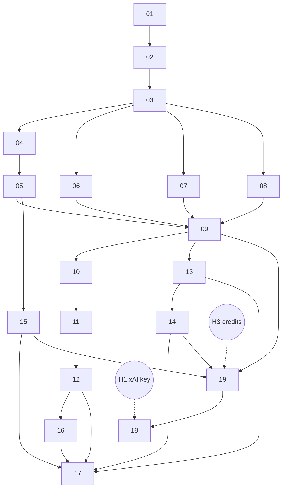

# Dependency graph

An edge `A → B` means B can't start until A is verified. The graph is acyclic (checked: every edge points from a lower ticket number to a higher one, except 19 → 18, and 18 has no outgoing edges).

| Edge | Reason |
|---|---|
| 01→02 | environment: needs the package and quality gate |
| 02→03 | data/schema: the graph writes events through `db.record` and uses the models |
| 03→04, 03→06, 03→07, 03→08 | hard contract: the seams (loader dispatch, `rules.validate`, `approval.route`, `payment.pay`) are defined in 03 |
| 04→05 | hard contract: the extractor consumes the RawDocument from every format |
| 05→09 | data: the eval runs on the golden extractions |
| 06→09, 07→09, 08→09 | hard contract: the eval asserts on rule IDs, routing and payment events |
| 05→15 | hard contract: the vision fallback reuses the extractor agent |
| 09→10 | the eval is the regression net for the ledger change; 10 turns the pending rows into real ones |
| 10→11 | data: inbox resolution must respect the ledger states (withdrawn, revision delta) |
| 11→12 | hard contract: the UI inbox reuses `inbox.py` |
| 12→16 | architecture: the ROI page lives in the Streamlit app |
| 09→13 | the risk score changes expected outcomes, and the eval guards it |
| 13→14 | hard contract: the adversarial files need the lookalike and risk rules |
| 12, 13, 14, 15, 16→17 | data: the presentation shows screenshots, the risk story, adversarial results, the OCR story and the ROI |
| 09, 14, 15→19 | the live pass covers the offline eval, the adversarial rows and the vision path |
| 19→18 | environment: the live harness and its budget are proven on Haiku before switching providers |
| H3⇢19, H1⇢18 | human action (see HUMAN-READINESS) |

No edges were added for merge conflicts. The conflict on `eval/expected_outcomes.yaml` between 10 and 13 is handled by integration order (WAVES.md), not by a blocking edge, because their behaviour is independent.
